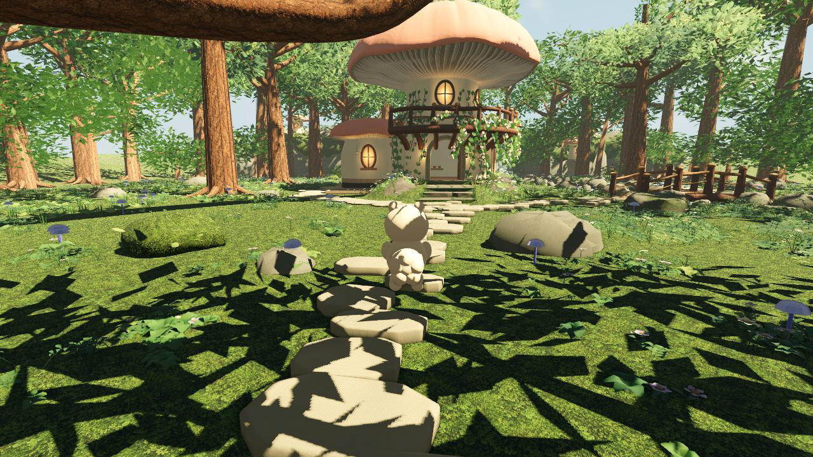
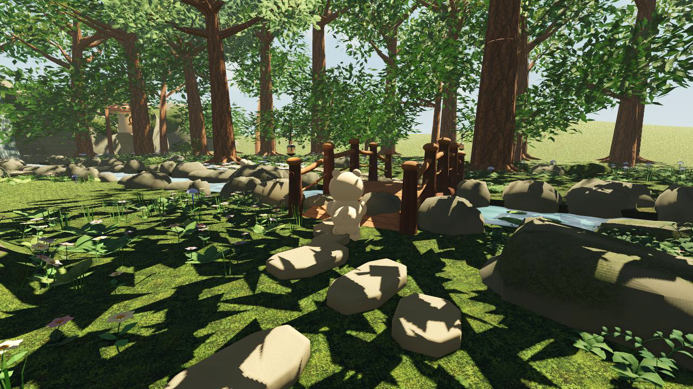

# Recorded MUSH demonstration

[Watch or download the MP4](MUSH-gameplay-demo.mp4) ·
[Read the 15-minute technical-demo runbook](MUSH-15-minute-demo-runbook.txt)

The 12-second video shows the real main scene and automated traversal toward the
mushroom home and bridge. It was captured from experimental 0.6.0 source at
[`9874b92`](https://github.com/xingzhao-ji/MUSH/tree/9874b92d65679ee6625fffa4511b7f6f64f8cfff)
using official Godot 4.7.2 and MovieWriter on a cloud computer with Mesa llvmpipe
and OpenGL compatibility. No mock screen or generated replacement scenery is used.

Rendering ran slower than playback. The clip does not measure real-time frame
rate, qualify manual play, or rerun the repository's Mac benchmark and gameplay
acceptance suites. The runbook is a separate 15-minute presentation plan; its
proposed live interactions and save round trip require rehearsal and are not all
demonstrated in this short recording.

## Screenshots

## Capture details

- H.264 MP4, 1280 × 720, 15 fps, 180 frames, 12 seconds.
- An AAC audio stream is present and contains nonzero samples. The clip should
  not be described as silent; audio quality was not reviewed by listening during
  publication.
- The original MP4, two screenshots and runbook are preserved byte for byte.
- Publication checks fully decoded the video, inspected both screenshots and
  twelve one-second video samples, and scanned the runbook and file metadata
  for recognizable credentials and personal paths.
- This directory is excluded from Godot asset imports by `.gdignore`.

Read [verification evidence](../VERIFICATION.md), [development status](../STATUS.md)
and [asset credits](../../assets/credits.json) for the existing acceptance gates,
prototype scope and attribution. These captures do not close those gates.
